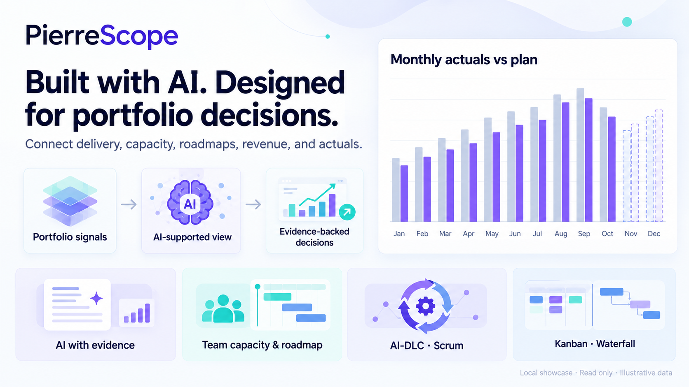
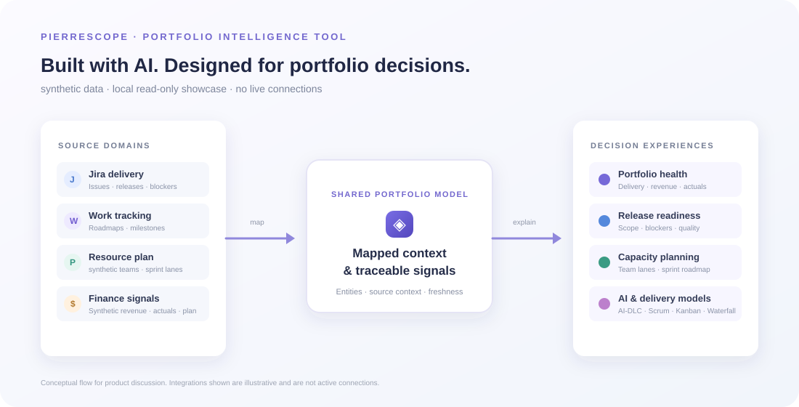

# PierreScope · Portfolio Intelligence Tool

**Built with AI. Designed for portfolio decisions.**

PierreScope is a real Portfolio Intelligence Tool that connects delivery, team capacity, roadmaps, revenue, and actuals. This package is a carefully limited public showcase: the interface and product story are real; sample records and figures are synthetic.

**Live showcase:** Add the published showcase URL here.  
**GitHub repository:** pierrescope-portfolio-intelligence

## What I built

I created PierreScope as an AI-assisted product effort, shaping a portfolio tool around the decisions leaders need to make. The product brings delivery signals, planning, team capacity, financial actuals, and executive-ready views together.

## Product capabilities and demo evidence

PierreScope supports portfolio decisions across Operations and Transformation. The product capability map below separates the broader product from the selected proof in this public showcase.

| Product capability | What the showcase demonstrates |
| --- | --- |
| **Operations** — implementation health, delivery risk, quality, and go-live readiness | Portfolio Overview; readiness evidence in Data & Integrations |
| **Transformation** — initiative, feature, and technology delivery, scope, and roadmaps | Roadmap and planning comparison in Planning & Capacity |
| **Financial intelligence** — budget, CAPEX/OPEX, revenue forecast, and actuals | Portfolio metrics and a 12-month actuals-versus-plan chart |
| **Resource planning** — team capacity and portfolio demand scenarios | Team-level baseline-versus-proposed comparison |
| **AI-supported decisions** — opportunity analysis and evidence-backed assistance | Saved examples with visible synthetic evidence; no live AI calls |
| **Delivery and leadership views** — AI-DLC, Scrum, Kanban, Waterfall, and executive-ready summaries | Delivery models in AI Examples; a sample brief in Data & Integrations |

The four interactive demo areas are **Portfolio Overview**, **AI Examples**, **Planning & Capacity**, and **Data & Integrations**. The product and its demonstrated capabilities are real; every record and figure in the showcase is synthetic.

## What this demonstrates about my AI work

I used AI in creating the product, and PierreScope includes AI capabilities for portfolio analysis. The public example focuses on two practical patterns:

- **Opportunity analysis:** a saved example connects delivery and capacity signals to a decision worth reviewing.
- **Evidence-backed assistance:** a saved response answers a portfolio question and shows the synthetic source signals behind it.

The demo keeps those examples static and reviewable. It makes no live model calls. The surrounding product design emphasizes visible evidence and human review. This describes the user-facing behavior without publishing prompts, scoring logic, internal mappings, or implementation details.

PierreScope also supports multiple delivery models: AI-DLC, Scrum, Kanban, and Waterfall. These are product capabilities, distinct from the saved AI examples.

## Example AI interaction

**Question:** What is most likely to put the demo release at risk?

**Saved example:** The release has near-term pressure because two demo issues remain open and a synthetic quality team reaches 94% planned load in Sprint 18. Review the issue evidence and proposed capacity before changing the release window.

**Supporting evidence shown in the demo:** DEMO-142 and DEMO-143; Atlas Quality capacity in Sprint 18; a synthetic actuals signal. These names and values are sample data, not records from the operational app.

## How the information connects

The diagram shows an illustrative product concept, not active integrations. The showcase runs read-only from static files. It does not connect to customer systems, databases, or AI providers.

## Visual walkthrough

- [Portfolio overview and multi-month financial chart](assets/screenshots/overview.png)
- [Saved AI examples and delivery models](assets/screenshots/ai-examples.png)
- [Team capacity and roadmap](assets/screenshots/planning-capacity.png)

## Run the showcase locally

With Node.js installed, run node server.js from this folder and open http://127.0.0.1:3210/. The server uses Node.js built-ins only. GitHub Pages or another static website host serves the files directly; neither needs this local preview server. See PUBLISHING_GUIDE.md for both hosting paths.

## Public boundary

This repository contains the deliberately limited showcase only. It excludes the operational application source, operational databases, credentials, customer records, named resource rosters, and internal configuration. The demo’s HTML, CSS, and JavaScript are visible when hosted; they are not the operational product core.

No commercial availability or release date is announced. No license is included; licensing decisions remain separate.

